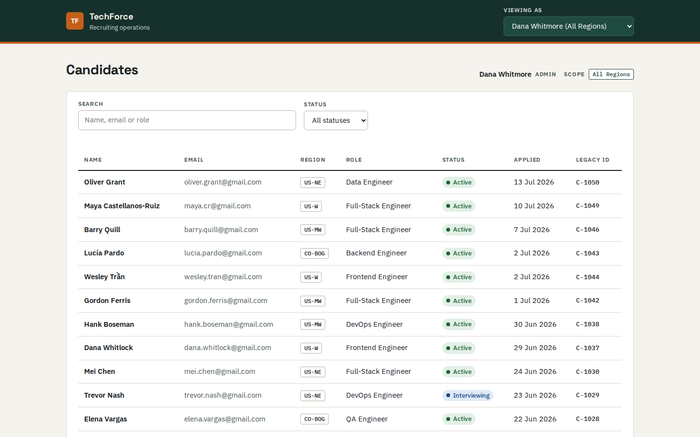
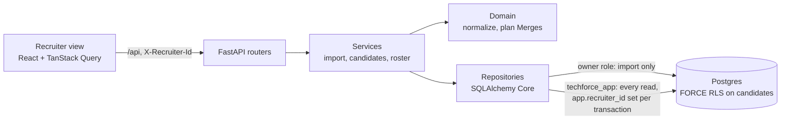
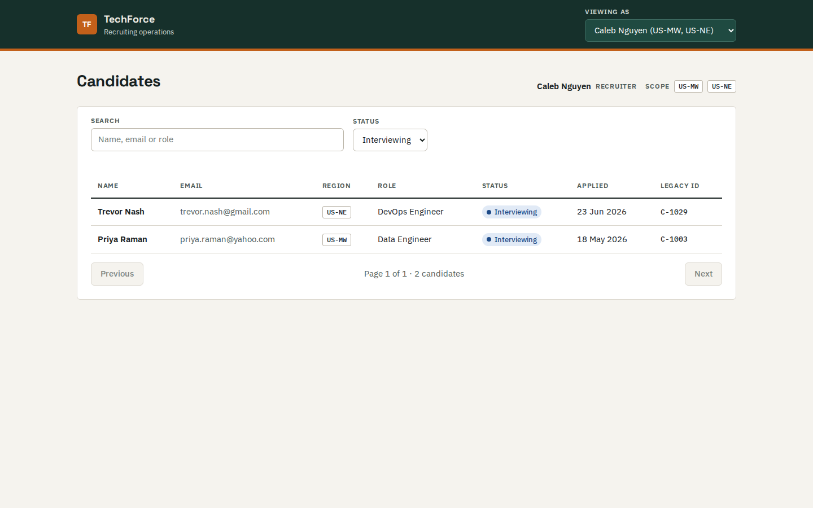
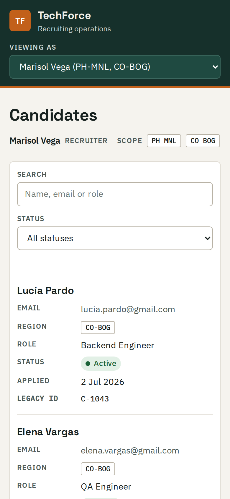

# TechForce Candidate Import & Recruiter View

TechForce's candidate records sit in a messy legacy export: the same person
appears under two IDs, one ID belongs to two people, emails are malformed,
dates come in three formats and salaries are typed by hand. This project
imports that export (`candidates_import.csv`) into PostgreSQL under documented
normalization and Merge rules, then shows each Recruiter only the Candidates in
their Regions.

Every row of the file ends up accounted for: imported as a new Candidate,
Merged into one already seen, or rejected with every reason that applies. The
Recruiter scope is enforced by PostgreSQL Row-Level Security, not by
application filters, so no future endpoint can leak another Region's rows.



- **Backend:** FastAPI (async), SQLAlchemy 2 Core on asyncpg, Alembic, uv. Python 3.12.
- **Frontend:** Vite, React 19, TypeScript and TanStack Query. Node 22.
- **Database:** Postgres 16.

The rules and judgement calls are in [NOTES.md](NOTES.md), the vocabulary is in
[GLOSSARY.md](GLOSSARY.md), and the decisions are in [docs/adr/](docs/adr/).

## How it fits together



- **Domain** (`backend/app/domain/`) is pure Python. `Candidate` applies the
  normalization rules, and `plan_import` decides, row by row, whether a record
  is new, a Merge or a Rejection. It never touches the database.
- **Services** own the transactions. The import runs in one transaction as the
  table owner, with a single bulk lookup and batched writes. Reads run as
  `techforce_app`, a role without `BYPASSRLS`, inside a transaction that sets
  `app.recruiter_id` locally, so a pooled connection can never carry one
  Recruiter's context to the next request.
- **Postgres** holds the guarantee. The scope policy admits a row only when the
  Recruiter in the transaction is an Admin or covers the row's Region. With no
  Recruiter set it admits nothing.

## Quick start (Docker only)

```sh
docker compose up
```

This builds the images on the first run (add `--build` after pulling changes)
and starts three services. The API runs the migrations on start: schema,
roles, RLS policies and the Recruiter roster.

| Service | URL |
| --- | --- |
| UI | http://localhost:5173 |
| API | http://localhost:8000 (e.g. `/api/v1/recruiters`, docs at `/docs`) |
| Postgres | `localhost:5433` |

Every port is bound to `127.0.0.1` only. Postgres uses host port 5433 so it
doesn't clash with a local Postgres on 5432. To change a port or a password,
copy `.env.example` to `.env` and edit `POSTGRES_HOST_PORT`, `API_HOST_PORT`,
`WEB_HOST_PORT` or the database settings.

The database starts empty. Import the CSV as the Admin (Dana, `R-101`):

```sh
curl -X POST http://localhost:8000/api/v1/candidates/import \
  -H "X-Recruiter-Id: R-101" -F file=@candidates_import.csv
```

Then open http://localhost:5173 and use **Viewing as** to switch between
Recruiters. Caleb Nguyen covers US-MW and US-NE (18 Candidates); Marisol Vega
covers PH-MNL and CO-BOG (9 Candidates).

To stop, run `docker compose down`. `docker compose down -v` also deletes the
database volume.

### Make shortcuts

If you have `make`, these wrap the same commands. Run `make` to list them all.

```sh
make up        # build and start db, api and web; returns once all three are healthy
make import    # import candidates_import.csv as the Admin and print the Import Report
make test      # backend suite (needs only Postgres) and the UI unit tests
make lint      # ruff, ESLint and the TypeScript compiler
make e2e       # Playwright e2e suite against the running stack
make down      # stop the stack (make reset also deletes the database volume)
```

## The recruiter view

The header shows who you are viewing as; the scope line under the title says
which Regions that covers, so a missing Candidate is explained rather than
mysterious. Search matches first name, last name, full name, email and role,
case-insensitively. The status filter and paging run in SQL under the same RLS
policy, so they can only narrow the scope.



When nothing matches, the view says whether the filters or the scope are the
reason and offers to clear the filters. A failed request shows the API's
message with a **Try again** button; client errors (401, 403, 422) are not
retried.

On a phone each Candidate becomes a labelled card:



Salary, phone and notes are stored but deliberately left out of the list
response.

## API

Identity is the `X-Recruiter-Id` header, standing in for real authentication.
A missing header returns 401 and an unknown ID returns 403. Interactive
OpenAPI docs are at http://localhost:8000/docs.

| Method | Path | Who | Purpose |
| --- | --- | --- | --- |
| `GET` | `/api/v1/recruiters` | anyone | The roster that feeds the switcher |
| `GET` | `/api/v1/candidates` | any Recruiter | Scoped list: `search`, `status`, `page`, `page_size` (max 100) |
| `POST` | `/api/v1/candidates/import` | Admin only | Multipart CSV upload (5 MB max); returns the Import Report |

These responses were captured from the compose stack.

**Import as the Admin.** The provided file gives 40 imported, 3 Merged and 10
rejected:

```sh
curl -X POST http://localhost:8000/api/v1/candidates/import \
  -H "X-Recruiter-Id: R-101" -F file=@candidates_import.csv
```

```json
{
  "imported": 40,
  "merged": 3,
  "rejected": [
    { "row": 34, "candidate_id": "C-1033", "reason": "invalid email" },
    { "row": 36, "candidate_id": "C-1035", "reason": "missing email" },
    { "row": 37, "candidate_id": "C-1036", "reason": "invalid characters in last_name" },
    { "row": 41, "candidate_id": "C-1040", "reason": "invalid date" },
    { "row": 46, "candidate_id": "C-1045", "reason": "unknown region" },
    { "row": 52, "candidate_id": "C-1010", "reason": "candidate_id collision" },
    { "row": 53, "candidate_id": "C-1051", "reason": "missing region_code" }
  ],
  "merges": [
    { "row": 31, "candidate_id": "C-1004", "merged_into": "C-1004" },
    { "row": 32, "candidate_id": "C-1031", "merged_into": "C-1001" }
  ]
}
```

(Shortened: the full report lists all 10 Rejections and all 3 Merges.)
Running the same import again is harmless: it reports 0 imported and 43 Merged,
because the database counts as first-seen.

**A non-Admin cannot import**, because a Merge fills blanks in existing
records:

```sh
curl -X POST http://localhost:8000/api/v1/candidates/import \
  -H "X-Recruiter-Id: R-102" -F file=@candidates_import.csv
```

```
HTTP/1.1 403 Forbidden
{"detail":"Only an Admin may import"}
```

**Read a scoped, filtered list:**

```sh
curl -H "X-Recruiter-Id: R-102" \
  "http://localhost:8000/api/v1/candidates?search=raman&status=interviewing"
```

```json
{
  "items": [
    {
      "id": 3,
      "legacy_id": "C-1003",
      "first_name": "Priya",
      "last_name": "Raman",
      "email": "priya.raman@yahoo.com",
      "region": "US-MW",
      "desired_role": "Data Engineer",
      "status": "interviewing",
      "applied_date": "2026-05-18"
    }
  ],
  "total": 1,
  "page": 1,
  "page_size": 25
}
```

## Local development

You need uv, Node 22 (see `frontend/.nvmrc`) and Docker (for Postgres).

```sh
docker compose up -d db              # Postgres only, on localhost:5433

# API on :8000. Settings default to localhost:5433; a repo-root .env overrides them.
cd backend
uv sync
uv run alembic upgrade head
uv run uvicorn --factory app.main:create_app --reload

# UI on :5173. In another shell; Vite proxies /api to localhost:8000.
cd frontend
npm ci
npm run dev
```

The compose `web` image copies the source rather than mounting it. After a UI
change, rebuild it with `docker compose up -d --build web`, or use
`npm run dev` as shown above.

## Tests and linting

**The backend suite** covers the domain rules, the HTTP API and the RLS
guarantees. It needs only the compose Postgres:

```sh
docker compose up -d db
cd backend && uv run pytest
```

It uses its own database, `techforce_test` (override with `TEST_DATABASE_NAME`).
The suite creates it if it's missing, migrates it once per session, and
truncates `candidates` between tests, so your dev data is never touched. The
headline RLS test runs a raw `SELECT * FROM candidates` as `techforce_app` and
checks that only the Recruiter's Regions come back.

**The UI unit tests** use Vitest and Testing Library with a stubbed `fetch`:

```sh
cd frontend && npm test
```

**The e2e suite** (marker `e2e`) is deselected by default. It drives the real
UI with Playwright against the running stack, importing the CSV through the
API first; re-importing is idempotent.

```sh
docker compose up -d --build
cd backend
uv run playwright install chromium   # once
uv run pytest -m e2e
```

Each e2e test reads the expected scoped total for its Recruiter from the API
and checks the UI shows the same, so extra imports don't break it. If the stack
isn't reachable the tests are skipped with a reason. `E2E_UI_URL` and
`E2E_API_URL` point them somewhere other than `127.0.0.1:5173` and `:8000`.

**Linting:** `uv run ruff check . && uv run ruff format --check .` in
`backend/`, and `npm run lint && npx tsc -b` in `frontend/` (or `make lint`).

## Design choices

- **Identity is the normalized email** ([ADR-0001](docs/adr/0001-candidate-identity-is-normalized-email.md)).
  The legacy `candidate_id` is stored and unique but secondary: the export
  reuses IDs across people and gives one person several IDs.
- **First-seen wins.** A later row for the same person only fills blanks, so a
  degraded duplicate (name "A.") never overwrites good data.
- **Scope lives in the database** ([ADR-0002](docs/adr/0002-recruiter-scoping-via-forced-rls.md)).
  RLS is forced, so even the table owner is subject to a policy, and reads use
  a role that cannot bypass it.
- **Nothing is repaired by guessing.** `[at]` in an email, `actve` as a status
  and an unknown Region are Rejections, not fuzzy matches. A row with more
  values than columns is rejected rather than imported with a truncated field.
- **The import is Admin-only.** NOTES.md explains how an open import became a
  data-integrity hole once the blank-filling Merge landed.

## Project layout

```
backend/
  app/
    api/           routers, request/response models, header-based identity
    domain/        Candidate normalization and import planning (no I/O)
    services/      use cases and transaction boundaries
    repositories/  SQLAlchemy Core queries
    db/            table metadata and the three kinds of connection
  migrations/      schema, roster seed, roles and RLS policies
  tests/           domain, API, RLS and e2e suites
frontend/src/      recruiter view components and their Vitest tests
docs/adr/          architecture decision records
```

## License

[MIT](LICENSE)
